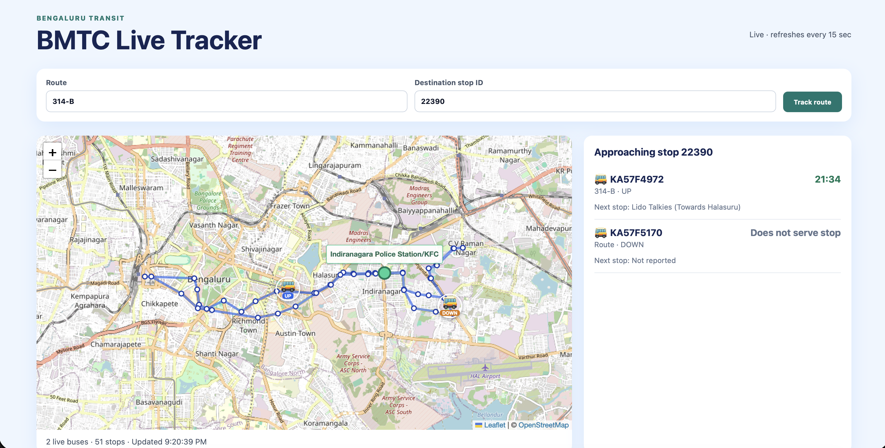
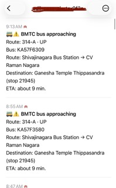
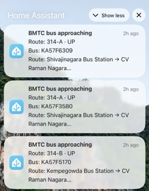
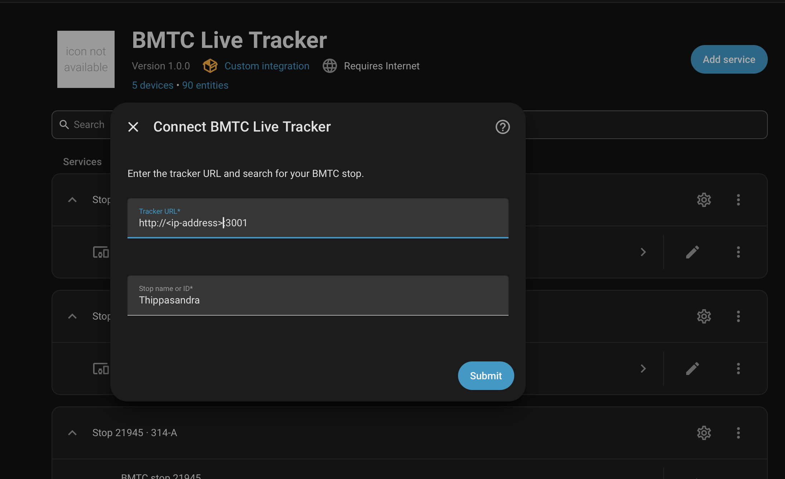
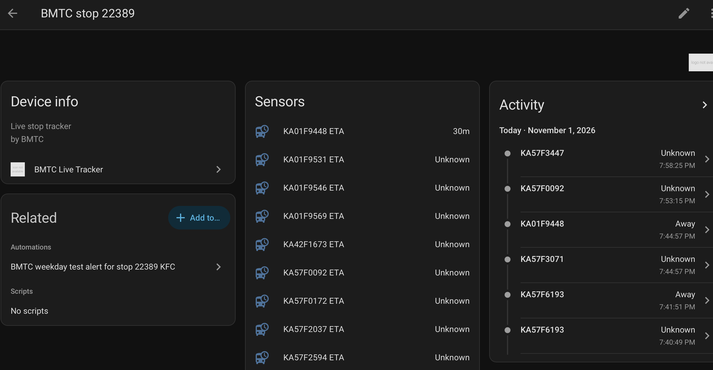

# BMTC Live Tracker

A full-stack tracker for live BMTC route vehicles using the `bengaluru-transit` TypeScript SDK. It starts on route **314-P** and destination stop **21945** or any other routes/stops, draws the route's reported stops, displays live buses, and queries each live vehicle's trip to list reported ETAs to the selected stop. 

The tracker exposes live transit data over HTTP. Home Assistant can consume that API through the included custom integration, then use its own automations, presence entities, schedules, scripts, and notification integrations to decide when and how to alert you.

A big thank you to the `bengaluru-transit` SDK [author](https://github.com/Sync271/bengaluru-transit) for making this possible. The SDK is a wrapper around the BMTC live-trip API, which is not officially documented or supported. 

> **⚠️ Disclaimer**: This is an **unofficial** SDK. It is not affiliated with, endorsed by, or connected to any official transit authority. This project is developed independently to solve a personal problem, and is not guaranteed to be reliable or accurate.

So the legal status of this project is unclear, and it may stop working at any time if the BMTC API changes. Use at your own risk.

Also the fact that some of the code is AI generated. Any new features or bug fixes are appreciated, and please open an issue or PR if you have any suggestions.

### Screenshots





## Prerequisites

- Node.js 20 or newer (the SDK requires Node 18+)
- npm 9 or newer

## Run locally

```bash
npm install
npm run dev
```

Open `http://localhost:5173`. The Vite development server proxies `/api` to the Express API at port 3001. Production builds are created with `npm run build`.

## Docker

```bash
docker compose up --build
```

Open `http://localhost:3001` or `http://<ip-address>:3001`. The container serves the built frontend and the Express API together; during development use Vite at port 5173.

## API

- `GET /health`
- `GET /api/routes?q=314-P`
- `GET /api/stops?q=Ganesha%20Temple`
- `GET /api/tracker?route=314-P&stop=21945`
- `GET /api/stop?stop=21945&route=314-P` (`route` is optional; omit it for every route serving the stop)

`/api/stops` searches by stop name and also accepts a numeric stop ID. `/api/tracker` returns GeoJSON for a route and its stops/live vehicles; `/api/stop` returns the live buses and ETAs reported for a stop.

## Structure

```text
apps/api       Express adapter around bengaluru-transit
apps/web       React + Vite + Leaflet interface
custom_components/bmtc_live_tracker  Home Assistant custom integration
Dockerfile     production API/image build
```

## Home Assistant integration

The included custom integration consumes this project's tracker API; the API must therefore be reachable from Home Assistant (for example, `http://bmtc-tracker:3001` when both run in Docker, or a LAN URL).

1. Copy the **contents** of `custom_components/bmtc_live_tracker` into Home Assistant's `config/custom_components/bmtc_live_tracker` directory. The resulting folder must contain `manifest.json` directly (not an extra nested `bmtc_live_tracker` folder). Restart Home Assistant.
2. Go to **Settings → Devices & services → Add integration**, then select **BMTC Live Tracker**.
3. Enter the tracker URL and a stop name or ID, then select the matching stop. Optionally enter a route number to narrow the results; leave it empty to include all routes serving that stop.



The integration creates a **Next bus ETA** sensor, an ETA sensor for each live bus, and a `device_tracker` entity for each bus with a reported location. ETA sensor attributes include the estimated wall-clock `arrival_time` in `Asia/Kolkata`, plus vehicle ID, route, direction, next stop, and position. Configure another integration entry for each stop/route combination you want to monitor. To change an entry's stop, open its options, search by stop name or ID, then select the matching result and optionally filter by route.



The state value and attributes would look like this for a bus approaching the selected stop:

```yaml
State: 5
Attributes:
  stop_id: '21945'
   route_filter: null
   arrival_time: null
   arrival_time_timezone: Asia/Kolkata
   next_bus:
     vehicleId: '25661'
     vehicleNumber: KA57F5279
     direction: up
     position:
       - 77.651042
       - 12.972461
     eta: '20:08'
     nextStop: Ganesha Temple Thippasandra (Towards BEML Gate)
     routeNo: 314-D
     servesTarget: true
     targetStopName: Ganesha Temple Thippasandra
     routeStart: Kempegowda Bus Station
     routeEnd: Malleshpalya New Bus Station(Vignananagar)
   buses:
     - vehicleId: '25661'
       vehicleNumber: KA57F5279
       direction: up
       position:
         - 77.651042
         - 12.972461
       eta: '20:08'
       nextStop: Ganesha Temple Thippasandra (Towards BEML Gate)
       routeNo: 314-D
       servesTarget: true
       targetStopName: Ganesha Temple Thippasandra
       routeStart: Kempegowda Bus Station
       routeEnd: Malleshpalya New Bus Station(Vignananagar)
```

Use the resulting entities in Home Assistant automations. This keeps schedules, weekday/weekend routes, home/away checks, and notification providers configurable in HA rather than in API environment variables. For example, an automation can watch a bus ETA sensor, check a `person` entity and weekday condition, then call one or more `notify.*` actions. Separate integration entries let automations choose different stops or routes on weekends.

Configure Lovelace cards to display the ETA sensor and bus trackers. The `bmtc_live_tracker` integration does not provide any Lovelace cards, but you can use the standard `entities`, `sensor`, or `map` cards to show the ETA sensor and bus trackers.

```yaml
type: markdown
title: BMTC buses — Stop 21945 all
content: |2-
    
    
    | Bus | Route | ETA | Next stop |
    |---|---|---|---|
    
    | {{ bus.attributes.vehicleNumber }} | {{ bus.attributes.routeNo }} | {{ bus.attributes.eta }} | {{ bus.attributes.nextStop }} |
    |---|---|---|---|
    
    
    No BMTC bus trackers found.
    
```

### Examples of Home Assistant automations

Notify when during config setup, we define stop 21945 and route 314-B, and the next bus is within 10 minutes. Only notify if the person is home and it's a weekday:
```yaml
alias: BMTC weekday commute alert
triggers:
  - trigger: numeric_state
    entity_id: sensor.bmtc_stop_21945_314_b_next_bus_eta
    below: 10
conditions:
  - condition: state
    entity_id: person.adil
    state: home
  - condition: time
    weekday: [mon, tue, wed, thu, fri]
actions:
  - action: notify.mobile_app_phone
    data:
      title: Bus approaching
      message: "Next bus ETA: {{ states('sensor.bmtc_stop_21945_314_b_next_bus_eta') }} minutes"
  - action: notify.ntfy
    data:
      title: Bus approaching
      message: "Next bus ETA: {{ states('sensor.bmtc_stop_21945_314_b_next_bus_eta') }} minutes"
mode: single
```

When we configure only the stop id, we get all the routes serving that stop. We then need to filter for the 314-series buses. The following automation will notify when 314-series bus is approaching, but only if the person is home and it's a weekday. Also send a announcement to a speaker connected to Home Assistant. It uses Kokero TTS (needs to be installed and configured) to announce the bus arrival on a Fire TV device. The automation is queued so that multiple buses arriving in quick succession will be announced one after another.:

```yaml
alias: BMTC weekday morning bus alert
description: Notify when a 314-series bus is within 15 minutes of the selected stop.
triggers:
  - trigger: state
    entity_id: sensor.bmtc_stop_21945_all_routes_next_bus_eta
    attribute: buses
conditions:
  - condition: time
    after: '08:00:00'
    before: '10:30:00'
    weekday:
      - mon
      - tue
      - wed
      - thu
      - fri
  - condition: template
    value_template: >-
        
        
        
        
          
        
       {{ ns.entered }}
actions:
  - variables:
      approaching: >-
          
          
          
          
            
          
         {{ ns.buses }}
  - action: notify.mobile_app_adils_iphone
    data:
      title: BMTC bus approaching
      message: >-
         Route {{ bus.routeNo }} — {{
        bus.vehicleNumber }} is about {{ bus.eta }} minutes away (arrival {{ bus.arrivalTime }}).  
  - action: openai_tts.say
    target:
      entity_id: media_player.adil_s_fire_tv
    data:
      tts_entity: tts.openai_tts_kokero
      message: >-
        Bus {{ repeat.item.get('vehicleNumber', repeat.item.get('vehicleId')) }}
        on route {{ repeat.item.get('routeNo', 'unknown') }} is about {{
        repeat.item.get('eta') }} away. Next stop: {{
        repeat.item.get('nextStop', 'not reported') }}.
mode: queued
```

Replace the example entity and notify service IDs with yours. Add a second integration entry for a weekend route and use a separate automation or a `choose` action to select the matching weekday/weekend sensor.

The API itself does not send notifications or decide when a commute is active. Configure those behaviors in HA using automations, scripts, helpers, and any installed notification integrations.
## Notes

The dashboard shows the ETA returned by the live-trip API; it does not invent a predicted arrival when the upstream data has no ETA. Vehicle and stop field names are normalized in `apps/api/src/transit.ts`, the only place that should need adjustment if the SDK changes its response shape.
